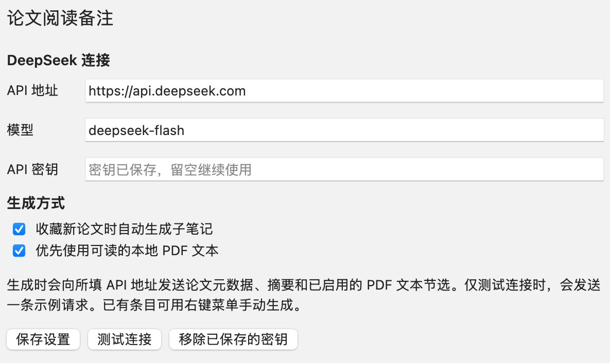

# Zotero 论文阅读备注 · DeepSeek

为收藏的论文生成中文 Zotero 子笔记。先用一句自然的话概括论文在解决什么问题，再分项整理任务、输入、输出、方法、实验、局限和资料来源。插件也为人体动作与交互论文保留了身体范围、Ego / Exo、物体与场景等字段。

> **AvatarPoser · 一句话任务**  
> 从头显和双手的跟踪数据实时重建虚拟化身的全身姿态。

## 安装与配置

1. 从 [GitHub Releases](https://github.com/haoning-Chen226/zotero-paper-note-deepseek/releases/latest) 下载 `zotero-paper-note-deepseek.xpi`。
2. 在 Zotero 桌面端打开 **工具 → 插件**，把安装包拖进插件管理器并确认安装。[Zotero 安装说明](https://www.zotero.org/support/plugins)
3. 打开 **设置 → 论文阅读备注**，填入自己的 DeepSeek API 密钥。默认 API 地址为 `https://api.deepseek.com`，默认模型为 `deepseek-flash`。兼容接口需支持 Chat Completions 和 JSON 输出。[DeepSeek API 文档](https://api-docs.deepseek.com/en/)
4. 点 **测试连接**。如需自动生成，勾选 **收藏新论文时自动生成子笔记**，然后点 **保存设置**。



安装清单支持 Zotero 7.0 至 10.0.x。已在 macOS 的 Zotero 10.0.9 中使用模拟 API 验证安装、设置、PDF 提取、自动与手动生成和去重。

## 生成笔记

- 开启自动生成后，插件会为**新收藏的论文**等待约 35 秒，让 Zotero 有时间保存附件。**已有论文**可右键选择 **生成论文阅读备注（DeepSeek）**。
- 插件优先提取本地 PDF 的可读文本，最多读取前 40 页、使用前 65,000 字符。PDF 不可读或尚未下载时，插件可用条目摘要生成。两种资料都缺失时，补齐后可从右键菜单生成。
- 笔记会列出实际使用的资料，并标明正文是否为节选。证据不足的字段留作待核对，会议和 DOI 来自已有资料，官方发表或录用信息需要另行核对。
- 笔记沿用条目的 `/unread` 或 `/read` 标签显示阅读状态。如果 Zotero 的「其他（Extra）」栏单独有一行 `阅读编号: E01` 或 `论文编号: E01`，标题也会沿用该编号。
- 同一条目已有插件生成的子笔记时，重复触发会跳过。取得更完整的 PDF 后，可以把旧的插件笔记移入回收站，再右键生成新版。

## 资料与密钥

生成时，所用论文元数据、摘要和启用的 PDF 文本会发送到你配置的 API 地址。关闭 **优先使用可读的本地 PDF 文本** 后，插件仅发送所用的条目元数据和摘要。连接测试使用一条示例请求。

API 密钥保存在 Zotero 的本地登录管理器，按 API 地址的来源查找。可在插件设置中点击 **移除已保存的密钥**。

## 从源码构建

在仓库根目录运行以下命令，生成的文件位于 `dist/zotero-paper-note-deepseek.xpi`。然后通过 Zotero 的 **工具 → 插件** 安装。

```sh
python3 scripts/build.py
```

- [`plugin/bootstrap.js`](plugin/bootstrap.js) 加载插件模块，并处理 Zotero 窗口与插件生命周期。
- [`plugin/content/plugin.js`](plugin/content/plugin.js) 管理条目监听、生成队列、PDF 提取、密钥存取和子笔记写入。
- [`plugin/content/deepseek.js`](plugin/content/deepseek.js) 处理 API 请求、超时、取消与 JSON 响应。
- [`plugin/content/note.js`](plugin/content/note.js) 定义提示词、校验来源链接并渲染笔记。
- [`plugin/content/settings.xhtml`](plugin/content/settings.xhtml) 和同目录的 `settings.js`、`settings.css` 提供 Zotero 设置界面。
